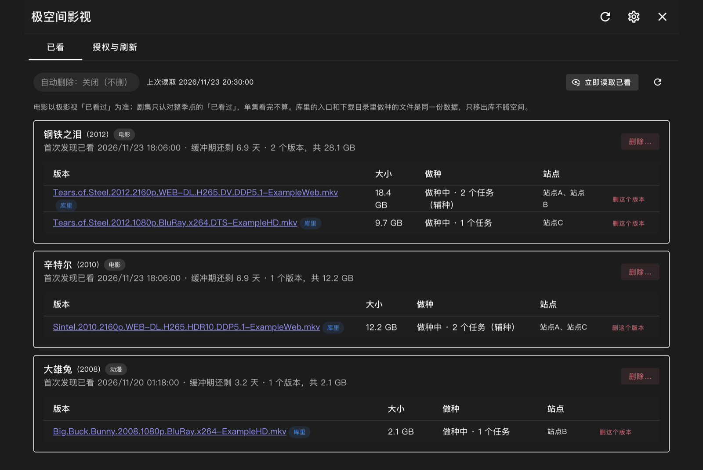
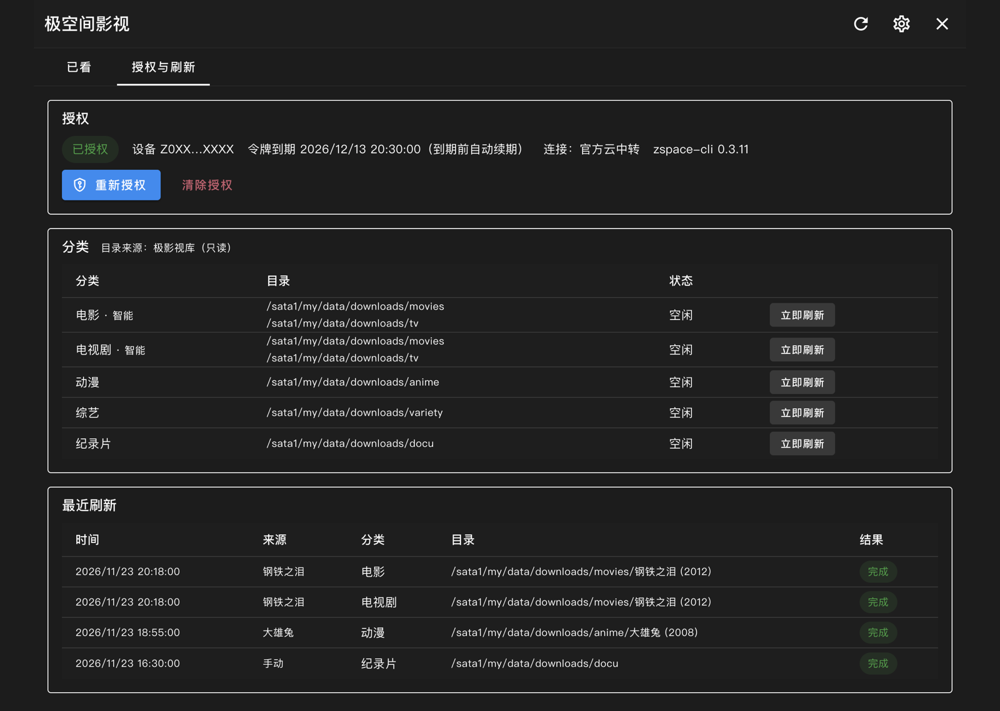
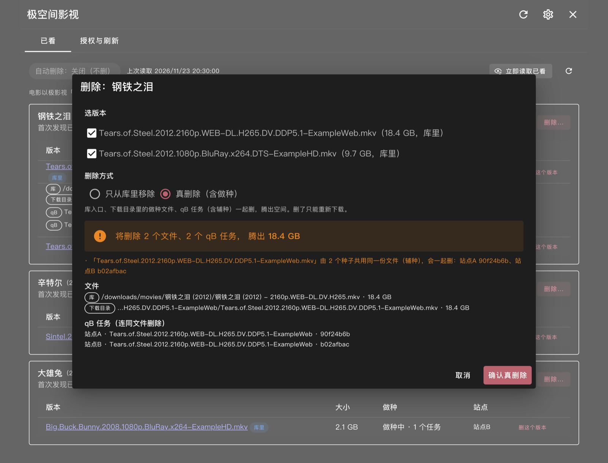
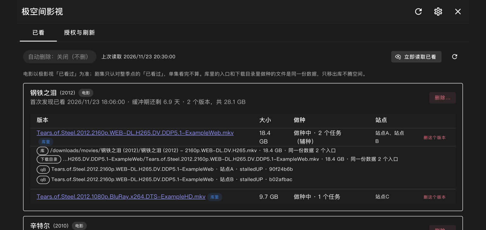
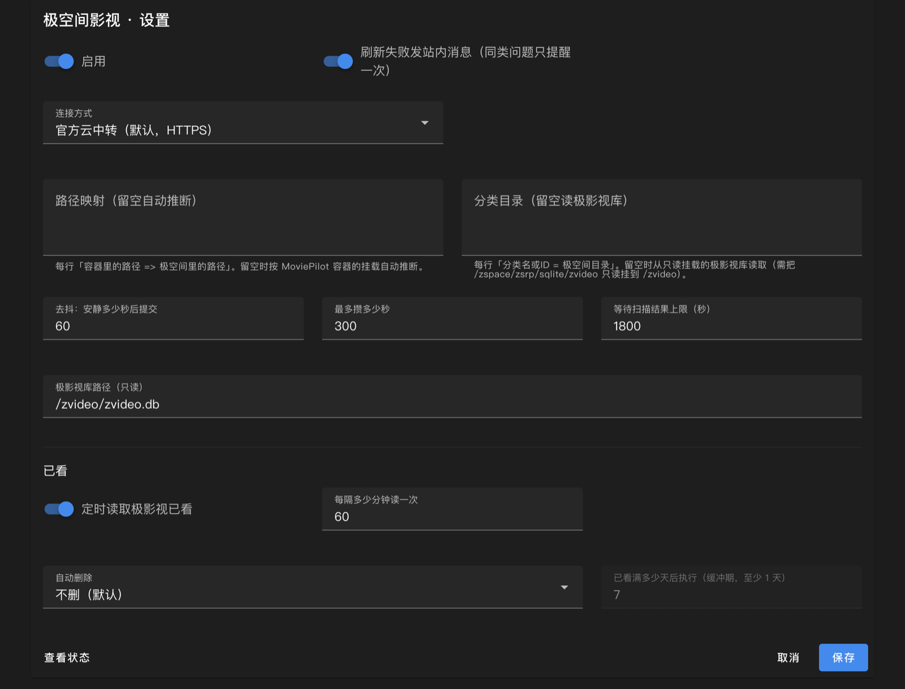
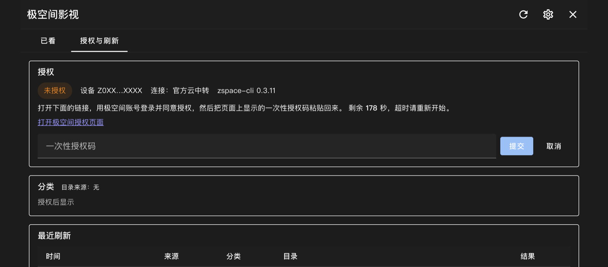

<p align="center"></p>

<div align="center">

# 🎬 极空间影视 · MoviePilot 插件

**用极空间官方授权连接极影视：MoviePilot 整理完只刷新对应目录；看完的片子集中列出，按你选的方式移出库或连同做种一起删除。**

     

</div>

<p align="center"></p>

> 截图里的片名、文件、站点和路径都是示例数据，界面是插件的真实页面。

## ✨ 能做什么

- **🔐 官方授权，不用 cookie**
  - 通过极空间官方 `zspace-cli`（zspace-nas-agent-toolkit）做 OAuth 授权：在插件页点「开始授权」，登录极空间，粘贴一次性授权码即可
  - 凭证只保存在插件数据目录（权限 0700），授权码不进日志、配置、命令参数和环境变量
- **🎯 整理完只刷新对应目录**
  - MoviePilot 整理完成后，找到包含该目录的极影视分类，只对这个目录发起「重新扫描」，并查询扫描任务直到完成
  - 一季十几集连续入库会合并成一次刷新（默认安静 60 秒、最多攒 300 秒）
  - 「电影」「电视剧」这类共享目录的智能分类会两边都刷
- **👀 已看列表**
  - 电影以极影视「已看过」为准；剧集只认对整季点的「已看过」，单集看完不算
  - 每部片（每季）列出家里的全部版本：洗版前后的不同文件、辅种、库入口和下载目录里的做种文件，按硬链接归成「同一份数据」，显示大小、做种状态和站点
- **🗑️ 三档删除，先预览再执行**
  - `不删`（默认）
  - `只从库里移除`：删库里的硬链接入口，下载目录里的文件继续做种，不腾空间
  - `真删除`：库入口、做种源文件、覆盖这份数据的全部 qB 任务（含辅种）一起删，腾出空间
  - 预览会冻结清单（每个文件的设备号、inode、大小、修改时间），执行前逐项核对，有一项变了整单不执行；执行后读回并刷新极影视
- **🛡️ 保守的默认值**
  - 剧集里认不出季号的文件（例如蓝光原盘 `BDMV/STREAM/*.m2ts`）真删除默认跳过，要在页面上勾选「确认属于第 N 季」才会纳入；自动删除永远跳过
  - 种子里还有不属于这部片或这一季的视频时，真删除整个版本不删
  - 自动删除默认关闭；打开后只处理**打开之后**才首次发现已看、且已过缓冲期（默认 7 天，最少 1 天）的条目

## 🖼️ 界面

| 授权与刷新 | 删除预览 |
|---|---|
|  |  |
| **一个版本的全部入口** | **设置** |
|  |  |

## 🆚 和基于 cookie 的插件有什么不同

| | 本插件 | 基于网页 cookie 的插件 |
|---|---|---|
| 登录方式 | 极空间官方 OAuth（`zspace-cli`） | 手动复制浏览器 cookie |
| 极影视数据库 | 只读挂载，只用来查「分类 ↔ 目录」 | 有的直接写 `zvideo.db` |
| 刷新范围 | 只刷新包含该目录的分类和目录 | 多为整库刷新 |
| 删除 | 预览冻结清单，执行前核对，默认不删 | — |

## 🚀 快速开始

### 1. 前置条件

- MoviePilot **V3**，版本 ≥ 3.2.8
- MoviePilot 跑在极空间的 Docker 里（Linux x64 或 arm64），能访问外网下载 `zspace-cli`
- 媒体目录是从极空间存储挂进容器的（插件按容器的挂载自动换算路径）
- 推荐：把极影视数据库目录**只读**挂进 MoviePilot 容器，插件从这里读「哪个分类包含哪些目录」

```yaml
services:
  moviepilot:
    volumes:
      - /sata1/my/data/downloads:/downloads          # 你的媒体与下载目录（示例）
      - /zspace/zsrp/sqlite/zvideo:/zvideo:ro         # 极影视数据库，只读
```

不挂这个目录也能用：在设置里手动填写「分类目录」（每行 `分类名或ID = 极空间目录`）。

### 2. 安装

- **第三方插件市场**：在 MoviePilot「设定 → 系统 → 插件市场」的地址里追加（多个地址用英文逗号分隔）：

  ```text
  https://github.com/xiaoyaner0201/MoviePilot-ZSpaceVideo/
  ```

  保存后在插件市场搜索「极空间影视」安装。
- **官方插件市场**：已准备向 [jxxghp/MoviePilot-Plugins](https://github.com/jxxghp/MoviePilot-Plugins) 申请收录，收录后可直接在官方市场安装。

### 3. 授权

<p align="center"></p>

1. 打开插件 →「授权与刷新」→「开始授权」。
2. 点「打开极空间授权页面」，用极空间账号登录并同意授权（链接 180 秒内有效）。
3. 把页面上显示的一次性授权码粘贴回来，点「提交」。

授权后，「分类」表会列出极影视的各个分类和对应目录。整理一部片试试，「最近刷新」里会出现一条记录。

### 4.（可选）已看与删除

在设置里打开「定时读取极影视已看」，「已看」页就会列出看完的片子。删除先在页面上手动做几次，确认预览和结果符合预期，再考虑打开自动删除。

## ⚠️ 删除前请读

- **真删除会删除做种文件和 qB 任务（含辅种），删了只能重新下载。** 默认选项是「不删」。
- 「只从库里移除」不腾空间：库里的入口和下载目录里做种的文件是同一份数据（硬链接）。
- 自动删除只处理打开开关之后才首次看完的条目，之前已经看过的只能手动删。缓冲期内在极空间客户端取消「已看」，就不会被删。
- qB 任务没删掉（qB 拒绝、超时或读不到）时，做种源文件一律保留，结果标为「部分完成」。
- 影片目录删完视频后，只在剩下的全是 nfo/海报/字幕时一起清掉；有任何别的文件就整个目录不动。
- 之后往上清理空目录时，每一层都只删真正空的目录，到媒体库的分类目录为止。
- 读极影视失败时保留的已看条目、一个已看标记推出多个季的专辑，都只能手动删，自动删除会跳过。
- 专辑里的文件被删光时，极影视会连同专辑和观看记录一起删除，这是极影视自己的行为。

## 🧩 已知限制

- **同一个极空间账号再次授权，会让之前的授权失效**（例如同一账号在别处也用 `zspace-cli` 登录过）。
- 局域网直连（`http://<NAS 地址>:5055`）走明文 HTTP，访问令牌会经过局域网；默认的官方云中转走 HTTPS。
- 极空间的「重新扫描」接口对不属于该分类、甚至不存在的路径也返回成功，所以插件要自己判断目录归属：读只读挂载的极影视数据库，或者用你手动填写的分类目录。
- `zspace-cli` 按版本、字节数和 SHA-256 固定（当前 0.3.11），官方发新版后需要插件跟进。

## 🔒 隐私与安全

- 插件只调用 `zspace-cli` 的分类、目录、重新扫描、扫描结果、已看列表和专辑文件查询，不修改极影视的分类、目录和已看标记，不写极影视数据库。
- 凭证、授权状态、刷新记录都只保存在 MoviePilot 的插件数据目录。
- 删除只作用于 MoviePilot 整理记录和下载记录能追溯到的文件；追溯不到的版本只展示，不删。

## 🛠️ 开发

```bash
# 单元测试（不需要 MoviePilot 后端）
python -m pip install 'pytest>=8'
python -m pytest -q tests

# 前端（Vue 联邦组件，构建产物在 plugins.v3/zspacevideo/dist/，随仓库提交）
cd plugins.v3/zspacevideo
npm ci
npm run build
```

目录结构与 [MoviePilot-Plugins](https://github.com/jxxghp/MoviePilot-Plugins) 的 V3 规范一致：插件在 `plugins.v3/zspacevideo/`，测试在 `tests/v3/zspacevideo/`，索引在 `package.v3.json`。

## 🙏 致谢

- [MoviePilot](https://github.com/jxxghp/MoviePilot) 与 [MoviePilot-Plugins](https://github.com/jxxghp/MoviePilot-Plugins)
- 极空间 zspace-nas-agent-toolkit（MIT），许可证见 [THIRD-PARTY-zspace-cli-LICENSE](THIRD-PARTY-zspace-cli-LICENSE)
- 截图里的示例片名来自 Blender 基金会的开放电影

## 📄 许可证

[GPL-3.0](LICENSE)，与 MoviePilot-Plugins 一致。

本项目非极空间官方出品，极空间及其产品外观为其所有者的商标。

<details>
<summary>English</summary>

# 🎬 ZSpace Video · MoviePilot plugin

**Connects MoviePilot to ZSpace's video library (极影视) through ZSpace's official OAuth. After MoviePilot organizes a title, only the matching folder is rescanned. Titles you have finished are listed in one place, and you choose whether to remove them from the library or delete them together with their seeding files.**

<p align="center"></p>

> Titles, files, sites and paths in the screenshots are sample data; the UI is the plugin's real page (in Chinese).

## ✨ Features

- **🔐 Official authorization, no cookies**
  - Uses ZSpace's official `zspace-cli` (zspace-nas-agent-toolkit) OAuth flow: click "Start authorization" in the plugin, sign in to ZSpace, paste the one-time code back
  - Credentials stay in the plugin data directory (mode 0700); the one-time code never reaches logs, config, command-line arguments or environment variables
- **🎯 Rescan only what changed**
  - After MoviePilot organizes a title, the plugin finds the video-library categories that contain that folder, asks ZSpace to rescan only that folder, and polls the scan task until it finishes
  - A season arriving episode by episode is merged into one rescan (60 s quiet period, 300 s cap by default)
  - Smart categories that share folders (Movies and TV Shows) are both rescanned
- **👀 Watched list**
  - Movies follow ZSpace's "watched" flag; for TV, only a whole-season "watched" mark counts, not single-episode progress
  - Each title (or season) lists every copy you have: versions before and after upgrades, cross-seeded torrents, library entries and seeding files in the download folder, grouped by hard link into "the same data", with size, seeding state and sites
- **🗑️ Three deletion modes, preview first**
  - `Keep` (default)
  - `Remove from library`: delete the library hard link; the download copy keeps seeding, no space is freed
  - `Delete for real`: the library entry, the seeding source files and every qBittorrent task covering that data (cross-seeds included) are removed, freeing space
  - The preview freezes a plan (device, inode, size and mtime of every file); execution re-checks each item and refuses the whole plan if anything changed, then reads back and rescans ZSpace
- **🛡️ Conservative defaults**
  - Files whose season cannot be told from the path (for example Blu-ray `BDMV/STREAM/*.m2ts`) are skipped by real deletion unless you tick "these belong to season N"; automatic deletion always skips them
  - If a torrent also contains videos of another title or season, real deletion leaves the whole version alone
  - Automatic deletion is off by default; when enabled it only handles titles first seen as watched **after** you turned it on and past the buffer period (7 days by default, at least 1 day)

## 🖼️ Screenshots

| Authorization & refresh | Deletion preview |
|---|---|
|  |  |
| **Every entry of one version** | **Settings** |
|  |  |

## 🆚 Compared with cookie-based plugins

| | This plugin | Cookie-based plugins |
|---|---|---|
| Sign-in | ZSpace official OAuth (`zspace-cli`) | Browser cookie copied by hand |
| Video database | Mounted read-only, used only to map categories to folders | Some write `zvideo.db` directly |
| Rescan scope | Only the categories and folder that changed | Usually the whole library |
| Deletion | Frozen preview, re-checked before running, off by default | — |

## 🚀 Quick start

### 1. Requirements

- MoviePilot **V3**, version 3.2.8 or later
- MoviePilot running in Docker on the ZSpace NAS (Linux x64 or arm64), with internet access to download `zspace-cli`
- Media folders mounted into the container from ZSpace storage (the plugin converts paths from the container's mounts)
- Recommended: mount ZSpace's video database folder **read-only**, so the plugin can read which category contains which folders

```yaml
services:
  moviepilot:
    volumes:
      - /sata1/my/data/downloads:/downloads          # your media/download folder (example)
      - /zspace/zsrp/sqlite/zvideo:/zvideo:ro         # ZSpace video database, read-only
```

Without that mount, fill in "category folders" in the settings instead (one `category name or ID = ZSpace folder` per line).

### 2. Install

- **Third-party market**: in MoviePilot, add this address to the plugin market list (comma-separated):

  ```text
  https://github.com/xiaoyaner0201/MoviePilot-ZSpaceVideo/
  ```

  Then search for "极空间影视" in the plugin market.
- **Official market**: a submission to [jxxghp/MoviePilot-Plugins](https://github.com/jxxghp/MoviePilot-Plugins) is being prepared; once accepted, it can be installed from the default market.

### 3. Authorize

<p align="center"></p>

1. Open the plugin → "授权与刷新" (Authorization & refresh) → "开始授权" (Start authorization).
2. Open the ZSpace authorization page, sign in and approve (the link is valid for 180 seconds).
3. Paste the one-time code shown on that page and submit.

After authorization the category table lists ZSpace's categories and folders. Organize a title in MoviePilot and a new row appears under recent rescans.

### 4. (Optional) Watched list and deletion

Turn on "read ZSpace watched state periodically" in the settings. Try deletion by hand a few times and check the preview and results before enabling automatic deletion.

## ⚠️ Before deleting

- **Real deletion removes seeding files and qBittorrent tasks (cross-seeds included); the only way back is downloading again.** The default is "Keep".
- "Remove from library" frees no space: the library entry and the seeding file in the download folder are the same data (hard links).
- Automatic deletion only handles titles first seen as watched after you enabled it; anything watched earlier must be deleted by hand. Un-marking "watched" in the ZSpace client during the buffer period cancels the deletion.
- If a qBittorrent task is not removed (refused, timed out or unreadable), its seeding files are kept and the result is marked partial.
- After the last video in a movie folder is deleted, the folder is cleaned only if everything left is .nfo, artwork or subtitles; any other file keeps the whole folder.
- Empty parent folders are then removed one level at a time, only while truly empty, stopping at the library category folder.
- Watched entries kept after a failed library read, and albums whose single watched mark spans several seasons, can only be deleted by hand; automatic deletion skips them.
- When every file of an album is gone, ZSpace's video library removes the album and its watch history; this is ZSpace's own behavior.

## 🧩 Known limitations

- **Authorizing the same ZSpace account again invalidates the previous authorization** (for example if the same account also signed in with `zspace-cli` elsewhere).
- LAN direct mode (`http://<NAS address>:5055`) uses plain HTTP, so the access token travels over your LAN; the default official cloud relay uses HTTPS.
- ZSpace's rescan API reports success even for folders outside the category or folders that do not exist, so the plugin decides folder ownership itself: from the read-only video database, or from the category folders you entered.
- `zspace-cli` is pinned by version, byte size and SHA-256 (currently 0.3.11); new upstream releases need a plugin update.

## 🔒 Privacy and safety

- The plugin only calls `zspace-cli` for categories, folders, rescans, scan results, the watched list and album files. It does not change ZSpace's categories, folders or watched marks, and never writes the video database.
- Credentials, authorization state and rescan history stay in MoviePilot's plugin data directory.
- Deletion only touches files traceable through MoviePilot's transfer and download history; untraceable versions are shown but never deleted.

## 🛠️ Development

```bash
# Unit tests (no MoviePilot backend needed)
python -m pip install 'pytest>=8'
python -m pytest -q tests

# Frontend (Vue federation component; build output in plugins.v3/zspacevideo/dist/ is committed)
cd plugins.v3/zspacevideo
npm ci
npm run build
```

The layout follows the V3 conventions of [MoviePilot-Plugins](https://github.com/jxxghp/MoviePilot-Plugins): plugin in `plugins.v3/zspacevideo/`, tests in `tests/v3/zspacevideo/`, index in `package.v3.json`.

## 🙏 Acknowledgements

- [MoviePilot](https://github.com/jxxghp/MoviePilot) and [MoviePilot-Plugins](https://github.com/jxxghp/MoviePilot-Plugins)
- ZSpace zspace-nas-agent-toolkit (MIT); license in [THIRD-PARTY-zspace-cli-LICENSE](THIRD-PARTY-zspace-cli-LICENSE)
- Sample titles in the screenshots are Blender Foundation open movies

## 📄 License

[GPL-3.0](LICENSE), same as MoviePilot-Plugins.

This project is not made by or affiliated with ZSpace. ZSpace and the look of its products are trademarks of their respective owners.

</details>
